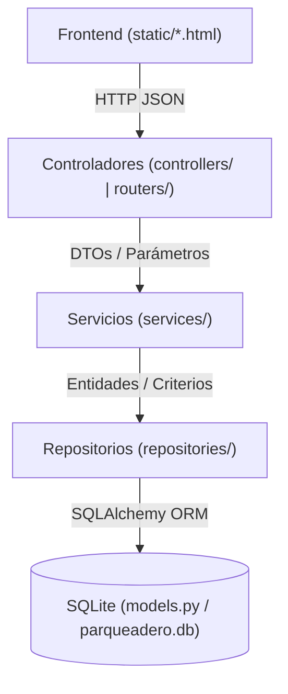

# Estructura de Carpetas Objetivo y Arquitectura por Capas — Sistema-PARQUEADERO

Este documento define la arquitectura objetivo del proyecto **Sistema-PARQUEADERO**, basada en **Arquitectura Limpia (Clean Architecture)** adaptada a un entorno de bajo consumo de recursos (**Zorin OS, Intel Core i5 2da gen, 4 GB RAM**).

---

## 1. Estructura de Carpetas Objetivo

```text
Sistema-PARQUEADERO/
├── main.py                              # Punto de entrada FastAPI, middlewares, registro de controladores y static/
├── database.py                          # Configuración de SQLite (engine, SessionLocal, get_db)
├── models.py                            # Capa de Dominio/Datos: Entidades ORM SQLAlchemy
├── schemas.py                           # Contratos DTO (Pydantic) de entrada y salida
│
├── migrations/                          # Motor ligero de migraciones reversibles (up / down)
│   ├── __init__.py
│   ├── runner.py                        # Gestor de versiones sobre tabla schema_migrations
│   └── v001_auth_auditoria_tickets.py   # Migración reversible: usuarios, sesiones, auditoria, tickets e índices
│
├── seeds/                               # Poblamiento inicial idempotente de datos
│   ├── __init__.py
│   └── seed_usuarios.py                 # Seed con bcrypt para "Admin" ("admin") y "Cajero" ("123456")
│
├── repositories/                        # CAPA DE REPOSITORIOS (Acceso a Datos / Persistencia)
│   ├── __init__.py
│   ├── ticket_repository.py             # Consultas SQLite de tickets (activos, filtros, borrado lógico)
│   ├── tipo_repository.py               # Consultas de tipos de vehículo y tarifas
│   ├── usuario_repository.py            # Consultas de usuarios por ID/nombre y actualización de hash
│   ├── sesion_repository.py             # Persistencia, validación y revocación de sesiones
│   └── auditoria_repository.py          # Inserción y consulta de registros de auditoría
│
├── services/                            # CAPA DE SERVICIOS (Lógica de Negocio / Casos de Uso)
│   ├── __init__.py
│   ├── ticket_service.py                # Reglas de cobro, precio_calculado vs precio_final, motivo_ajuste, soft-delete
│   ├── tipo_service.py                  # Creación/actualización de tarifas con trazabilidad en auditoría
│   ├── auth_service.py                  # Autenticación bcrypt, manejo de sesiones y cambio de contraseña
│   └── auditoria_service.py             # Servicio transversal de auditoría (quién, acción, entidad, antes/después)
│
├── controllers/ (y routers/)            # CAPA DE CONTROLADORES (Transporte HTTP / FastAPI Routers)
│   ├── __init__.py
│   ├── tickets.py                       # Endpoints /ticket (ingreso, pre-salida, salida, listado, borrado lógico)
│   ├── tipos.py                         # Endpoints /tipos-vehiculo
│   ├── auth.py                          # Endpoints /auth (login, logout, sesión actual, cambiar-password)
│   └── auditoria.py                     # Endpoints /auditoria (consulta de bitácora para rol admin)
│
├── static/                              # CAPA DE PRESENTACIÓN FRONTEND (HTML5 + CSS3 + Vanilla JS)
│   ├── index.html                       # Operación de caja (ingreso, liquidación con motivo de ajuste, salida)
│   ├── registros.html                   # Historial de tickets (activos/finalizados, filtros, reimpresión, borrado lógico)
│   ├── configuracion.html               # Gestión de tarifas y cambio de contraseña (exigiendo contraseña anterior)
│   ├── login.html                       # Inicio de sesión para Admin y Cajero
│   ├── ticket.html                      # [INTOCABLE] Plantilla de impresión térmica POS 80mm
│   └── style.css                        # Estilos UI + [INTOCABLE] reglas @media print y .pos-ticket
│
├── tests/ (y test_main.py)              # Suite de pruebas automatizadas (pytest + SQLite en memoria)
│   ├── test_migraciones_y_seed.py       # Pruebas de migración reversible up/down y seed bcrypt
│   ├── test_auth_y_usuarios.py          # Pruebas de login, sesiones, roles y cambio de contraseña
│   ├── test_tickets_y_auditoria.py      # Pruebas de precio_calculado/final, motivo_ajuste, borrado lógico y auditoría
│   └── ...
│
└── docs/                                # Documentación de arquitectura, reglas y coordinación entre agentes
    ├── agents.md                        # Reglas obligatorias para todos los agentes
    ├── arquitectura.md                  # Este documento (estructura de carpetas y diseño por capas)
    ├── esquema-bd-migraciones.md        # Diseño de BD, migraciones reversibles, índices y seed
    ├── ESTADO-COORDINACION.md           # Canal de solicitudes y contratos entre Backend y Frontend
    ├── avance.md                        # Tablero de control de tareas y estados
    └── signals/                         # Señales de sincronización del flujo de trabajo
        ├── 1A.done
        └── 1B.done
```

> **Nota de compatibilidad con `routers/`:** En `main.py` actualmente se importa `from routers import tipos, tickets`. Para evitar rupturas, los controladores HTTP pueden residir en `controllers/` y reexportarse en `routers/` (o mantenerse sincronizados), garantizando que `main.py` y `test_main.py` sigan funcionando de forma transparente.

---

## 2. Responsabilidades y Regla de Dependencia entre Capas

El flujo de dependencias es estrictamente unidireccional:



### 2.1. Capa de Controladores (`controllers/` / `routers/`)
- **Responsabilidad:** Recibir la petición HTTP, validar el esquema de entrada con Pydantic (`schemas.py`), extraer el usuario/sesión actual, invocar al Servicio correspondiente y devolver la respuesta HTTP con el código de estado adecuado.
- **Restricción:** Prohibido escribir consultas `db.query(...)` o fórmulas de negocio dentro de los controladores.

### 2.2. Capa de Servicios (`services/`)
- **Responsabilidad:** Contener todas las reglas de negocio del parqueadero:
  - Cálculo de `total_horas` y `precio_calculado` (< 12h por hora, 12–24h tarifa día, > 24h por días).
  - Determinación de `precio_final` y validación de obligatoriedad de `motivo_ajuste` cuando el cajero o admin ajusta el valor manualmente.
  - Sincronización de `precio_total = precio_final` para preservar intacto el contrato de impresión con `static/ticket.html`.
  - Borrado lógico de tickets (`eliminado = True`, `estado = 'ELIMINADO'`).
  - Verificación y generación de hashes `bcrypt`, validación de `password_anterior` al cambiar contraseña y gestión de expiración de sesiones.
  - Invocación a `auditoria_service` para registrar `quien`, `accion`, `entidad`, `antes`, `despues` y `fecha`.
- **Restricción:** No depende de objetos propios de la capa HTTP o del navegador.

### 2.3. Capa de Repositorios (`repositories/`)
- **Responsabilidad:** Encapsular todas las operaciones de lectura y escritura contra SQLite mediante SQLAlchemy (`Session`).
- **Restricción:** Por defecto, las consultas de listado y búsqueda de tickets filtran `Ticket.eliminado == False` (salvo consultas específicas de auditoría), aprovechando los índices `ix_tickets_fecha_ingreso`, `ix_tickets_estado` y `ix_tickets_placa`.

### 2.4. Capa de Dominio y Persistencia (`models.py`, `database.py`, `migrations/`, `seeds/`)
- **Responsabilidad:** Definir la estructura de las tablas (`TipoVehiculo`, `Ticket`, `Usuario`, `Sesion`, `Auditoria`), los índices de base de datos, las migraciones reversibles (`up`/`down`) y el seed inicial de usuarios.
